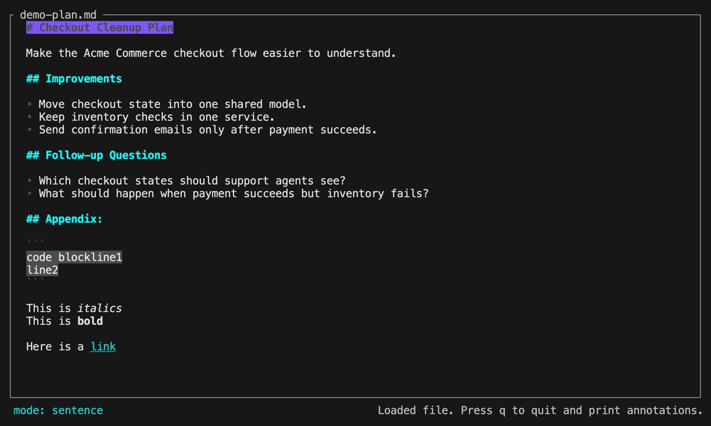

[](https://github.com/mattorb/rep/actions/workflows/ci.yml)
[](LICENSE)

# Rep

A human in the loop TUI to review and revise LLM generated markdown plan files quickly.



For agent-loop usage, wrap your agent harness in a tmux session so the skill can launch the rep UI modally.


## Overview

`rep` opens a markdown file in an interactive TUI optimized for providing feedback and requesting changes from an LLM.

When you exit `rep`, it prints a list of [requested changes](#emitted-annotations-example) for an AI agent to process and apply to the markdown plan. These changes can be a mix of deletions, additions, changes, and intent guidance.

For the most seamless experience, launch Codex or Claude Code *inside a tmux session*, which allows rep to launch as modal from a skill and automatically pass the revisions you ask it for back into the agentic loop.

## Installation
Install the latest macOS or Linux release to `~/.local/bin`, and the bundled agent skill source to `~/.agents/skills/rep`, with this command:

```sh
curl -fsSL https://raw.githubusercontent.com/mattorb/rep/main/install.sh | sh
```

After installing the skill source, the installer offers to symlink it into the supported agent skill directories for Claude, Codex, Gemini, opencode, Hermes, and Droid. The prompt works with the `curl | sh` form when an interactive terminal is available.

To install or update only the skill source and optional agent symlinks later:

```sh
curl -fsSL https://raw.githubusercontent.com/mattorb/rep/main/install.sh | sh -s -- --skills-only
```

This source install path installs the `rep` binary only.

## Usage

### Preferred
Use the rep skill to launch in the agentic loop: `/rep` in Claude Code or `$rep` in Codex.

### Manual fallback
If you execute it manually like this, you'll have to copy and paste results back to the agent.
```sh
rep plan.md
```

## Keybindings

| Key | Action |
| --- | --- |
| `j`, `Down`, `Right` | Move to the next active unit |
| `k`, `Up`, `Left` | Move to the previous active unit |
| `Space` | Cycle to the next selection unit |
| `Backspace` | Cycle to the previous selection unit |
| `i` | Use a finer selection unit |
| `o` | Use a coarser selection unit |
| `c` | Add or edit a literal change request |
| `f` | Add or edit feedback or intent |
| `b` | Insert text before the current unit |
| `a` | Insert text after the current unit |
| `x` | Clear existing annotations or mark the unit for deletion |
| `e` | Edit an existing annotation |
| `[`, `]` | Jump to the previous or next annotation |
| `/` | Search |
| `n`, `N` | Jump to the next or previous search match |
| `?`, `Shift` + `/` | Open or close help |
| `I` | Open or close the document structure view |
| `O` | Reveal links for the current selection |
| `r` | Copy annotations to the clipboard |
| `q` | Quit and send annotations |
| `Q` | Quit silently and discard annotations |
| `Enter` | Save text in change, feedback, insert, edit, or search modes |
| `Esc` | Cancel the current input mode or close an open popup |

## Platform Support

| Platform | Release artifact | CI coverage | Support status |
| --- | --- | --- | --- |
| Linux x86_64 | `x86_64-unknown-linux-musl` | Build, package, archive smoke test, and installer smoke test on GitHub-hosted Ubuntu | Supported |
| Linux arm64 | `aarch64-unknown-linux-musl` | Cross-build, package, archive smoke test, and installer smoke test on GitHub-hosted Ubuntu | Supported |
| macOS x86_64 | `x86_64-apple-darwin` | Build and tests on GitHub-hosted macOS | Supported |
| macOS arm64 | `aarch64-apple-darwin` | Cross-target release build on GitHub-hosted macOS | Supported |

Linux release artifacts are static MUSL builds.

## Emitted Annotations Example
On exit, something like this prints to stdout, for the LLM agent to consume and make modifications to the markdown plan file.

```text
FILE: plan.md

ACTION: change
WHERE: line 12 sentence 2
CONTEXT:
  prev: The release workflow builds archives for every configured target.
  target: Windows artifacts are published even though the installer and tests do not cover Windows.
  next: Checksums are generated after packaging.
CHANGE: Stop publishing Windows archives until CI and installer support are added.
```

## Rep for HTML plans (experimental)

Rep can review a local static `.html` or `.htm` plan in a browser while
preserving its HTML/CSS layout. This experimental browser workflow is separate
from the Markdown TUI documented above.

### Launching a review

Use `/rep` in Claude Code or `$rep` in Codex for the complete review-and-apply
loop. The bundled skill selects browser mode from the plan's extension, waits
for your confirmed review, applies the emitted actions, and closes its temporary
browser session.

To run the browser UI directly:

```sh
rep --web plan.html
```

`--web` is required for `.html` and `.htm` files (matched
case-insensitively), and rejects other file types. Rep runs in the foreground,
binds only to `127.0.0.1`, and opens a fresh authenticated review URL. Use
`--no-open` to open that URL yourself, including through an SSH port forward:

```sh
rep --web --no-open plan.html
```

Keep Rep running and open the complete URL it prints to stderr; the path
contains the session token. `--debug` validates and describes the launch
without starting the server or browser. The built-in `rep --demo` remains
Markdown-only; use [`examples/demo-plan.html`](examples/demo-plan.html) for an
HTML example. The [HTML review gallery](web/gallery/index.html) shows the
browser UI.

The skill runner needs Chromium, Chrome, Edge, Brave, or Firefox. Set
`REP_BROWSER_BIN` to an executable when automatic browser detection is not
appropriate. The release binary embeds the browser UI, so running it does not
require Node.

### Reviewing the plan

HTML reviews start in Section mode and use the same keybindings and annotation
actions as the TUI. The selection cycle remains:

```text
Section -> Paragraph -> Line -> Sentence -> Word
```

Review order follows visible DOM order rather than CSS columns or viewport
wrapping. Hidden content, generated pseudo-elements, canvas or image pixels,
and plan-owned shadow DOM are not selectable. A paragraph is a visible review
block; a line splits only at `<br>` or a preformatted newline. Click once for a
word, twice for a sentence (or logical line), and three times for the entire
review block. `I` opens the HTML outline with element and source context, and
`O` reveals the original and resolved links for the current selection.

Press `q` and confirm to submit the review, or `Q` to discard it without
output. Direct runs print confirmed actions to stdout; the skill captures them
and resumes the agent loop. Closing or reloading the tab does not end Rep, so
you can reopen the same URL while the foreground process is active. A session
with no browser or HTTP activity expires after 24 hours. If clipboard access is
denied, `r` opens the output in a selectable fallback dialog.

### Static rendering and safety

Rep renders a sanitized copy in a sandboxed iframe and does not rewrite the
source file. It retains elements, inline styles, responsive CSS, and supported
local stylesheets, images, and fonts, subject to these limits:

- Document scripts, event handlers, forms, nested frames, plugins, navigation,
  downloads, refresh directives, and CSP/base overrides are removed or blocked.
- Relative assets are served only when their canonical paths remain beneath
  the plan's directory; symlink escapes and `../` traversal are rejected.
- Data-URI images and fonts are supported. Remote and root-relative resources
  are blocked and reported in the UI.
- HTML must be UTF-8 and no larger than 10 MiB. Local assets have separate size
  limits.
- The loopback server uses a fresh 256-bit URL token and accepts only
  same-origin requests for that session.

JavaScript-dependent layouts are not supported; export a static HTML plan
instead. If an asset is blocked, make its URL relative to the plan and keep its
resolved path inside the plan directory. If a stale tab reports that the review
is unavailable, start a new review to get a fresh URL.

### Emitted annotations

HTML uses the same actions and payloads as Markdown, adding `FORMAT: html` and a
source locator:

```text
FILE: plan.html
FORMAT: html

ACTION: change
WHERE: line 18 sentence 1
LOCATOR: #release-plan
CONTEXT:
  prev: Scope is fixed for this iteration.
  target: Publish every target immediately.
  next: Checksums follow packaging.
CHANGE: Gate publishing on the supported target matrix.
```

`WHERE` is a source-line hint. The bundled skill uses `LOCATOR` plus normalized
target and neighboring context to verify the source before editing it.

## License
MIT — see [LICENSE](LICENSE).
